# Nordle

*Created by [Samuel Young](https://github.com/samuel-d-young). Free to use and build on under [CC BY 4.0](LICENSE): credit him, see [ATTRIBUTION.md](ATTRIBUTION.md).*

A local social-media studio where **Claude is the designer** and you are the art director. Claude plans the month, designs
the posts (carousels, single graphics, **reels cut from your real footage**), writes the captions, and **checks its own
work**; you open the Studio, step through what is ready, and approve, ask for changes, or move things around yourself.

<p align="center">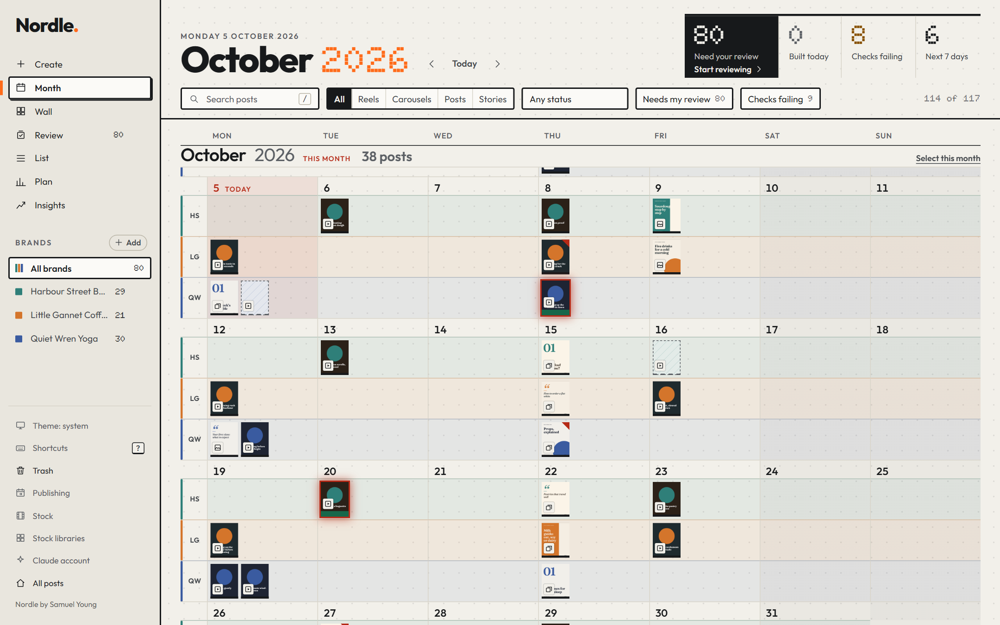</p>

*The Studio, showing a month for three made-up brands. Every brand, post and number in the screenshots in this README is invented.*

What makes it different from a template tool:

- **Claude designs, then judges.** Layout patterns give it well-spaced pages in your brand's own house style; a design
  critique grades every page out of 100 (hierarchy, spacing, collisions, contrast, consistency) and says how to fix it.
- **It triple-checks.** Automatic checks (wording against your industry rules, facts like phone numbers and names, a caption
  that matches the photo or clip under it, a speaker never cut off mid-sentence, B-roll that fits what is being said, no
  repeated photos in a month, sound levels) → the designer Claude records its own judgement → an independent reviewer Claude
  re-judges from scratch. A post only counts as *verified* when all three agree at its current version.
- **It plans ahead.** Claude proposes ideas for the next months, you approve them, and it builds each post as the date
  gets close (off until you switch it on). Nothing is posted for you.
- **You stay in control.** Every edit by Claude is versioned, lockable, reversible, and can be set to *suggest* only.

Early release (v0.1): it works, it is tested, and it is still changing. See the guides in `docs/` and `SECURITY.md`.

On a Mac? See [docs/MACOS.md](docs/MACOS.md) (Homebrew install, the Command key, what is tested).

**Testing it for someone else, or having a friend try it?** [SHARE-PROMPT.md](SHARE-PROMPT.md) has a one-paste prompt that installs Nordle, tries it, and writes a report to send back.

Want to see the whole workflow work before you trust it? Paste the prompt in [docs/SELF-TEST.md](docs/SELF-TEST.md): Claude uses the Studio on three brands and reports what worked and what broke.

## What it makes

All of this was made by Nordle from the made-up Little Gannet Coffee sample brand. Each post is one small document, and the same document comes out in every size.

<p align="center">
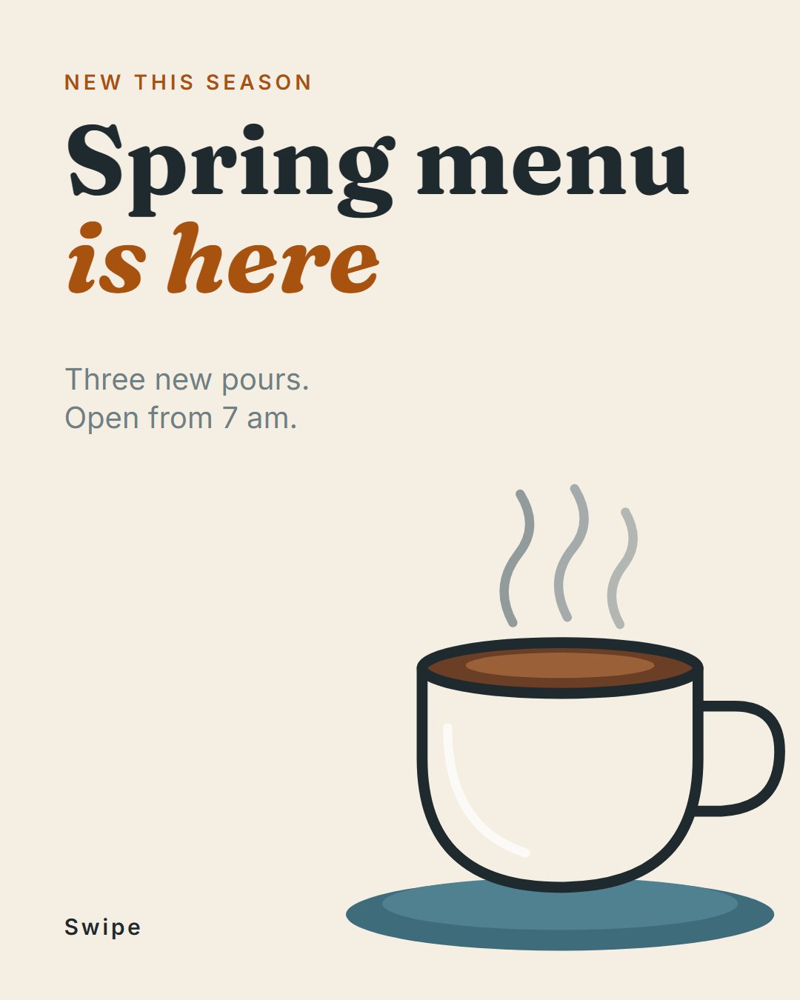
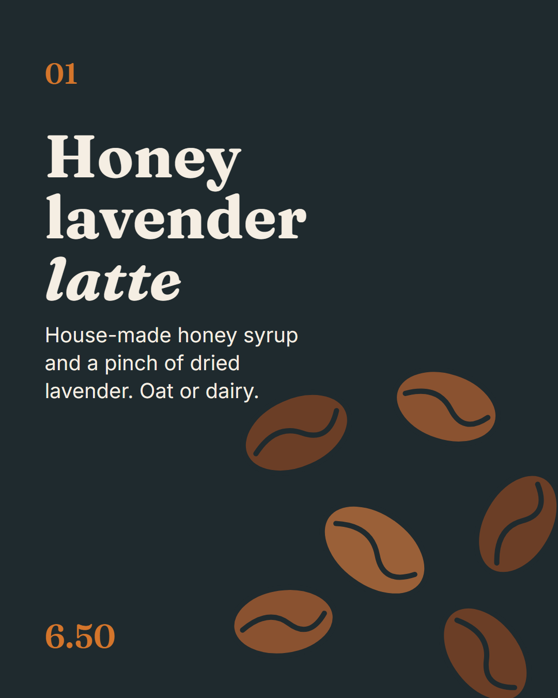
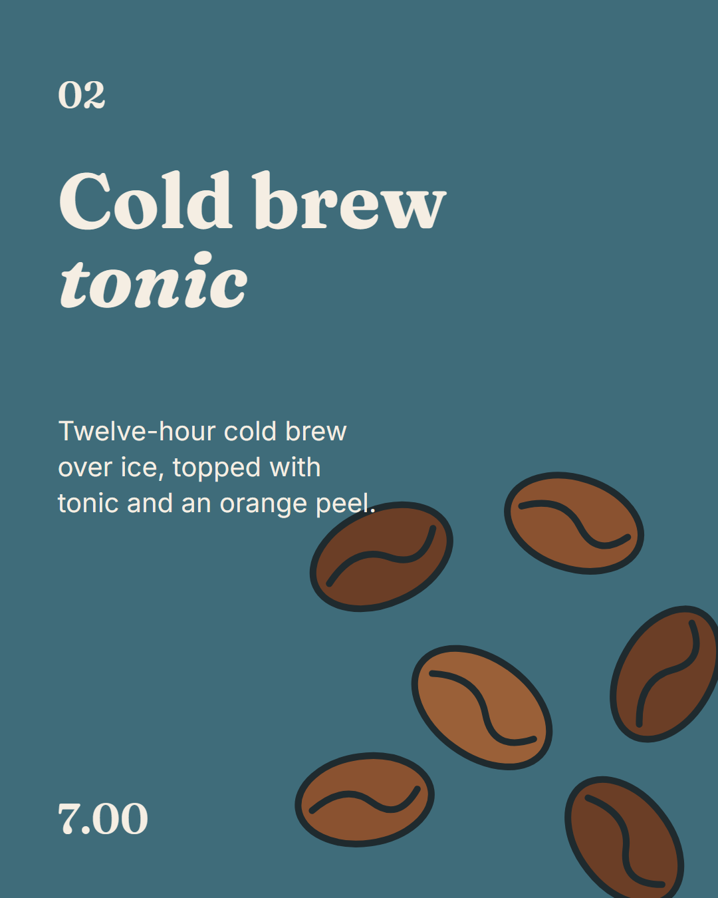
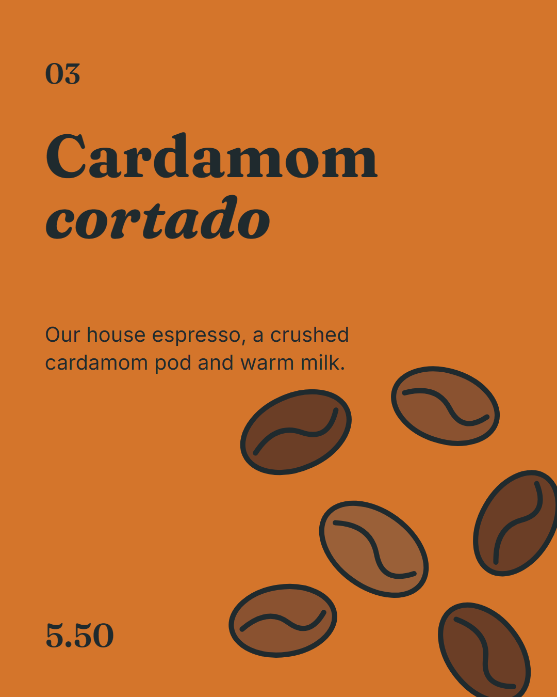
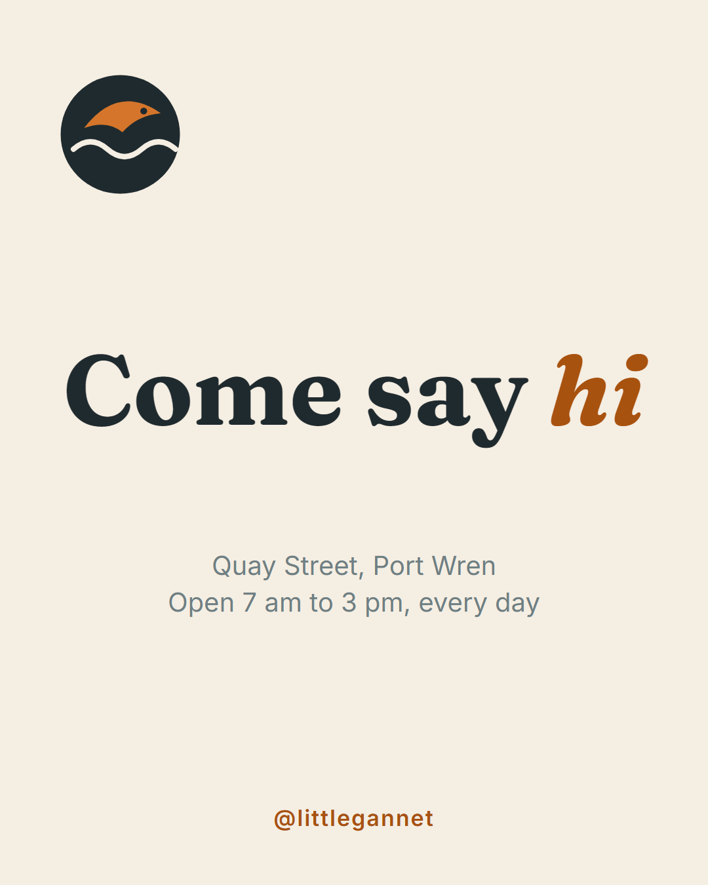
</p>

<p align="center">
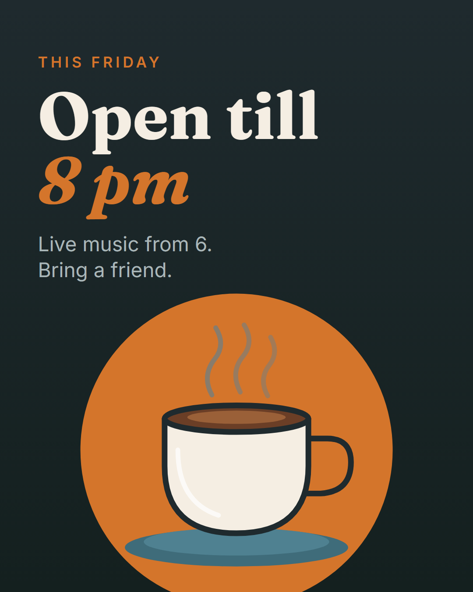
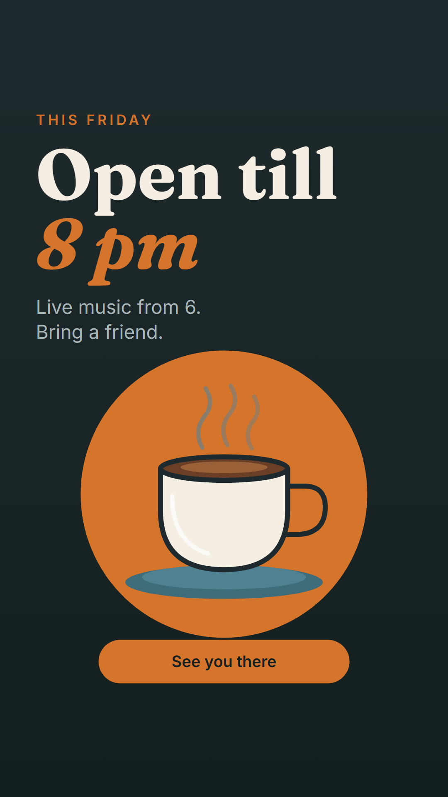

</p>

*A five-page carousel, one graphic in two sizes, and a motion-graphics reel with no footage (a small GIF preview). How to make them again: [examples/gallery](examples/gallery/README.md).*

## A look around

**Review queue.** Steps through what is waiting: approve, ask for changes with pins on the picture, or reject. The caption, checks and comments sit beside the post.

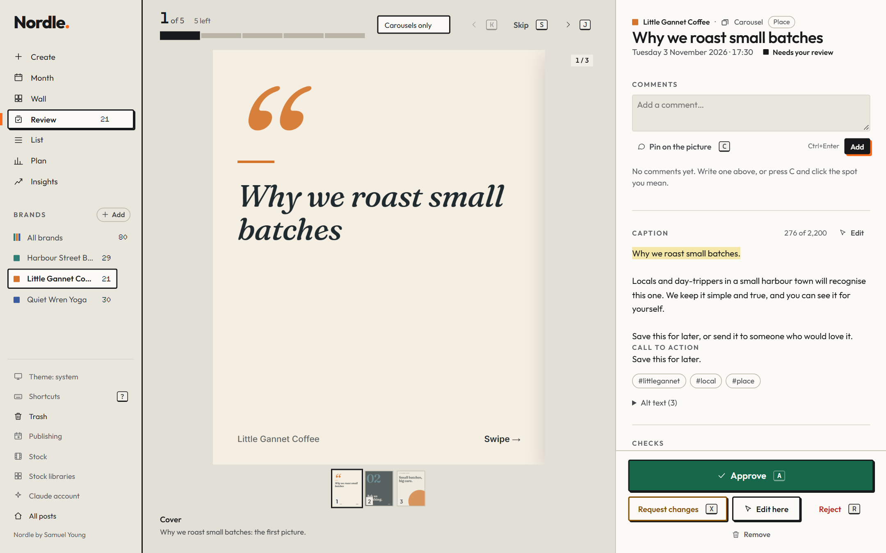

**The wall, and a post's sheet.** Every post as a thumbnail, by week; open one for the big preview, its pages, its checks and who made them.

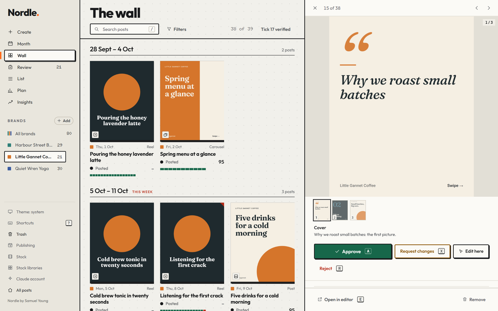

**The plan.** Monthly quotas, the mix of themes against your aim, the gaps, and the idea backlog you approve or reject.

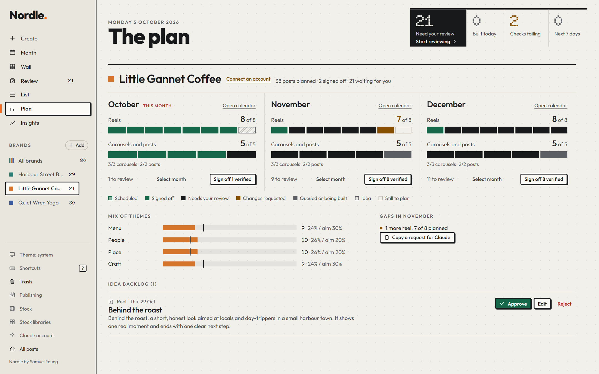

**Insights.** What worked and what did not, scored against the account's own history, with every group showing how many posts it rests on (small groups are labelled "directional only"). *The numbers here are invented.*

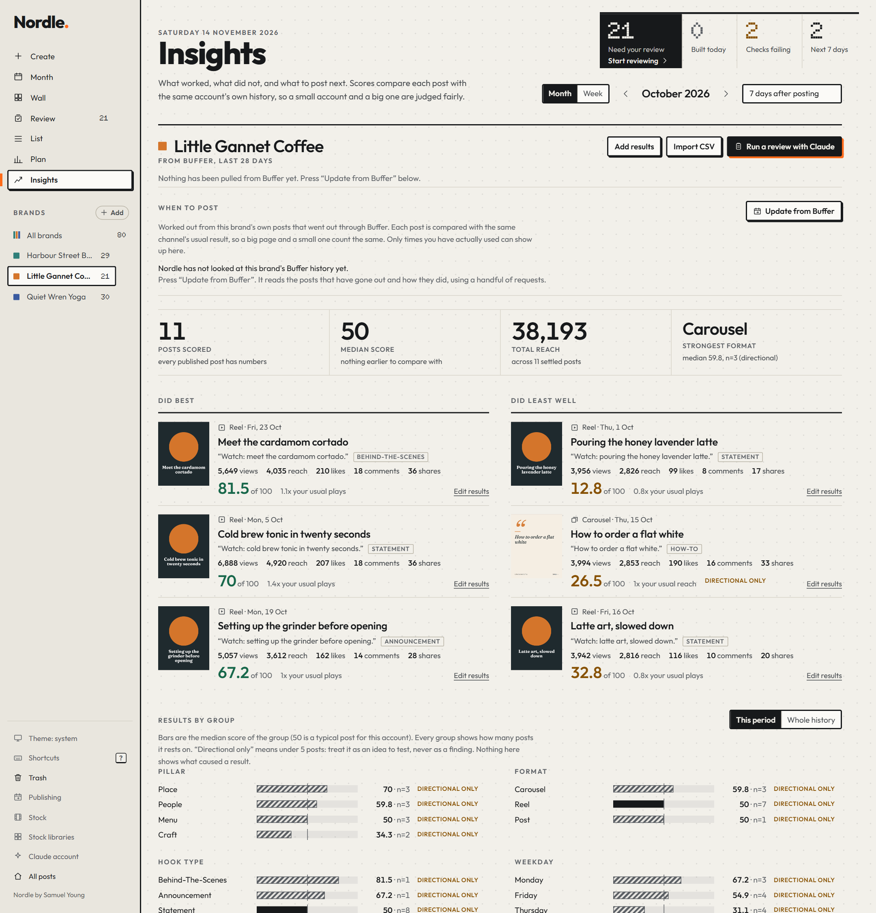

**The editor.** Pick any post and change it by hand: text, images, shapes, every size at once, safe zones, and a lock on anything Claude must not touch.

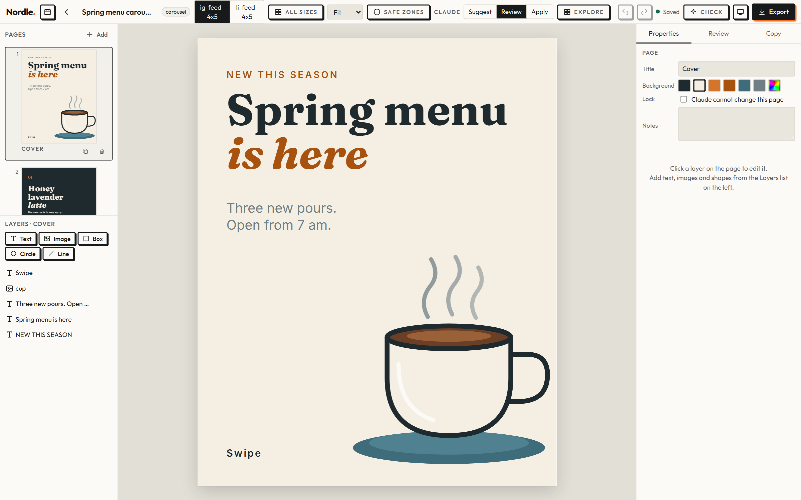

## Install (two minutes)

You need:

- **Node.js 20 or newer.**
- **Claude Code, signed in.** Nordle asks Claude to plan, design and check, so builds use your own Claude plan: about 1 to 2 dollars to build a
  picture post and up to 5 dollars for a reel. Every run is capped and says what it cost. Without Claude Code you can still open the sample,
  edit by hand and render; the planning and building need it.
- **ffmpeg**, for video posts only (never bundled).

Nordle only puts a new post in Buffer when you press Schedule, or after you switch on automatic scheduling yourself. Once Buffer is connected it
also keeps Buffer matching your calendar: if you move, reject or un-approve a post, its copy in Buffer is moved or deleted (posts made by hand in
Buffer are never touched; turn this off with `autoSync: { enabled: false }` in the publishing settings, see [docs/PUBLISHING.md](docs/PUBLISHING.md)).
It checks GitHub for a newer version at most once every six hours (a plain request, nothing about you is sent); turn that off with `NORDLE_NO_UPDATE_CHECK=1`.

```bash
git clone https://github.com/samuel-d-young/nordle-socials-creator nordle && cd nordle
node setup.mjs --register      # installs, gets the drawing browser (~170 MB once), connects Claude Code, copies the skill
node server.mjs --open         # the Studio, at http://127.0.0.1:5400
```

Or paste [SHARE-PROMPT.md](SHARE-PROMPT.md) into Claude Code and let it do all of that for you. Restart Claude Code once so the
`nordle_*` tools appear. The first run copies a fictional sample project (a coffee shop) so there is something to open.

**Connect Buffer.** In the Studio open Publishing and press **Sign in with Buffer** (you approve Nordle on Buffer's own page and nothing is pasted), or paste a
Buffer API key instead. See [docs/PUBLISHING.md](docs/PUBLISHING.md) for what each way does.

## The Studio (front door)

Month calendar (all brands in colour-coded lanes, or one), Wall of thumbnails, List, a **Review queue** that steps through
posts waiting for you (`a` approve, `x` request changes, `r` reject, `j`/`k` next/previous), and a **Plan** view with
monthly quotas, the idea backlog (approve / edit / reject), and the gaps in next month. Open any post for the big preview
(carousel strip, or a real video player with key frames), the caption with its hook marked, the checks and who made them,
the words-versus-picture pairs, comments and history. Light, dark, phone-friendly, keyboard-driven.

## Working with Claude

```bash
claude mcp add --scope user nordle -- node /path/to/nordle/mcp.mjs     # setup.mjs --register does this
```

Then ask in plain words: *"Plan November for my practice"*, *"Make a 6-slide carousel about mouthguards"*, *"Cut the footage in
`footage/` into a 25-second reel with captions"*, *"Check my comments and fix them"*. Claude reads the brand and facts,
writes a short brief, starts from a layout pattern (`nordle_compose_page`) or a reel spec, **looks at its own result as a
picture**, runs the critique and the checks, and only then calls the post ready (`nordle_finish`). More: the skill in
`skills/nordle/SKILL.md` and `docs/AGENT-GUIDE.md`.

The dial in the editor's top bar sets how far Claude may go on each post: **Review** (default; applied and flagged for you),
**Suggest** (nothing changes until you accept), **Apply**. Locks hold in every mode. Claude cannot approve, undo, or change the dial.

## Projects, brands and what goes in them

A project is a folder per brand under `projects/`:

```
brand.json            colours, fonts, logos, voice, and the `posts` house style (how patterns should look for this brand)
facts.json            the only source for phone numbers, addresses, staff names/titles, services (every fact has a source)
nordle.project.json   rule packs that apply (e.g. an advertising-wording pack) and the timezone
nordle.local.json     this computer's folders for footage and music ("mounts"): footage is never copied
assets/photos + catalog.json   what each photo really shows (written after looking), with traps and "do not use" flags
sources/catalog.json           the same for clips, with usable ranges and what is said
calendar.json         the plan: ideas, dates, status; docs/ posts; checks/ who checked what; out/ renders
```

## Video

`kind: "video"` documents render to MP4 with the ffmpeg already on your computer (never bundled): footage and photos on
picture tracks with cuts, fades and slides, zoom/pan, a warm grade, captions word by word from a transcript, titles and
brand cards as timed layers, music that ducks under the speaker (-14 LUFS). `docs/VIDEO.md` has the format. A 27-second reel
from 4K footage renders in under a minute. Build one from a short **reel spec** with `node nordle.mjs reel`, or open it in the editor
for a real timeline: move, trim and split clips, delete words in the transcript to cut them out, keyframe a title, see the true picture
at any moment, render a preview and export (`docs/VIDEO.md`, "Editing in the editor").

## Command line

```
node nordle.mjs doctor                         check this computer
node nordle.mjs validate [paths] [--assets]    check documents, brands, packs, calendars  (also: node tools/validate.mjs)
node nordle.mjs build <project> <spec.json>    spec -> post -> critique -> contact sheet
node nordle.mjs reel <project> <spec.json> [--sheet|--stills a,b|--render]
node nordle.mjs critique|verify|render <doc|project>
node nordle.mjs check|packet|record|finish <project> <doc>    the three-layer check and the gate
node nordle.mjs calendar status|list|propose|approve|due|prompt|run|schedule-install ...
node nordle.mjs video render|stills|sheet|check|probe <doc>
node server.mjs --open                         the Studio and editor
npm test                                       the whole test suite
```

## Security

The server listens on 127.0.0.1 only, answers only to localhost host names, needs a per-run token for every API call, sends
no CORS headers, caps request sizes, and serves your files with a locked-down content policy. Pages are rendered in a browser
that can only read the project folder and the bundled fonts. Claude gets its own, weaker token. Read [SECURITY.md](SECURITY.md).

Licence: [CC BY 4.0](LICENSE). Nordle was created by Samuel Young: if you share it, rebuild it or build on it you must credit him and link to this repository, and say if you changed it (see [ATTRIBUTION.md](ATTRIBUTION.md)). Nothing you make *with* Nordle needs a credit. The sample brand is fictional; see [LICENSES.md](LICENSES.md) for everything shipped or depended on.
